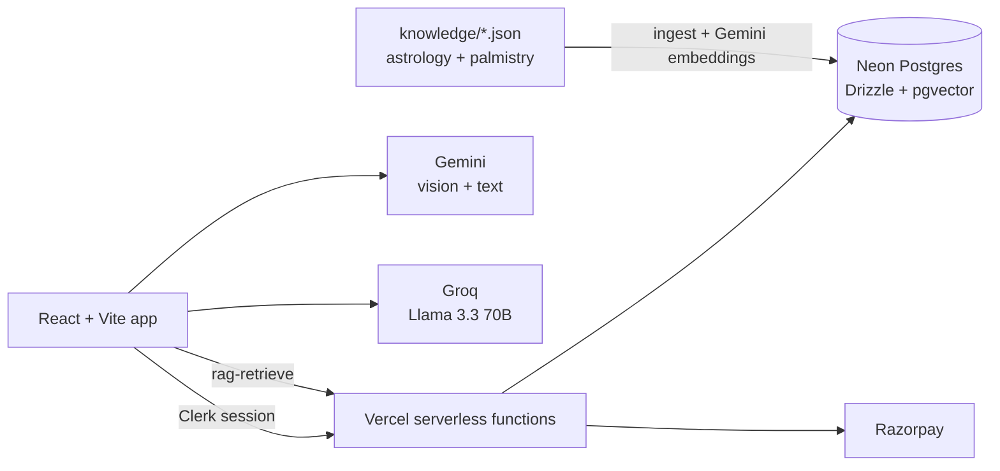

<h1 align="center">Shubhmilan AI</h1>

<p align="center">
  <b>Marriage biodata, kundli matching and palm reading, with AI that shows its sources.</b><br/>
  React · TypeScript · Vercel serverless · Neon Postgres + pgvector · Gemini · Groq
</p>

<p align="center">
  
</p>

---

## What it does

| | Feature | How it works |
|---|---|---|
| 📝 | **Biodata builder** | Guided form with community-specific fields, AI rewrites of the "about me" section, designer A4 templates and PDF export. Fields can be prefilled from an ID card using in-browser OCR. |
| 🪐 | **Kundli** | Birth chart from real planetary positions (`astronomy-engine`, Lahiri ayanamsa), panchang and a vivah muhurat finder, with an AI explanation in plain language. |
| 💞 | **Compatibility** | Ashtakoot guna milan (36 points) with dosha checks, explained in plain language. |
| ✋ | **Palm reading** | Two-pass pipeline: a vision model detects palm features, RAG pulls matching palmistry knowledge, then a grounded reading is written with source attribution. |
| 💳 | **Payments** | Razorpay orders for premium PDFs and kundli reports, verified on the server before anything is unlocked. |

## Architecture



## Engineering highlights

- **Compute first, generate second.** Planetary positions, panchang and guna scores come from deterministic code in `src/lib/jyotish` and `src/lib/panchang.ts`. The LLM explains results; it does not invent them.
- **Grounded, cited readings.** A curated knowledge base (nakshatras, doshas, remedies, muhurta, palm lines, mounts, shapes, signs) is embedded into pgvector. Readings retrieve from it and show where each claim came from.
- **Observe, then interpret.** Palm reading separates a vision pass (what is visible) from a text pass (what it means), which keeps the model from describing features that are not in the photo.
- **Server-verified payments.** Razorpay orders are created and signatures verified in serverless functions, never trusted from the client.
- **Typed end to end.** TypeScript across app and API, Zod validation on forms, Drizzle schema and migrations.
- **AI usage tracking.** A dedicated endpoint records model usage per feature.

## Tech stack

| Layer | Tools |
|---|---|
| Frontend | React 19, Vite, TypeScript, Tailwind CSS, Radix UI, Framer Motion, React Hook Form + Zod, Zustand, TanStack Query |
| Backend | Vercel serverless functions (`/api`), Clerk auth |
| Data | Neon serverless Postgres, Drizzle ORM, pgvector |
| AI | Gemini (vision, text, embeddings), Groq (Llama 3.3 70B), Tesseract.js OCR |
| Other | Razorpay, astronomy-engine, jsPDF + html2canvas |

## Getting started

```bash
git clone https://github.com/builtbynidhi/Shubhmilan-AI.git
cd Shubhmilan-AI
npm install
cp .env.example .env.local      # add your Neon, Clerk, Gemini, Groq and Razorpay keys

npm run db:migrate              # create tables
npm run ingest:astrology        # embed the astrology knowledge base
npm run ingest:palmistry        # embed the palmistry knowledge base

vercel dev                      # runs the app and the /api functions locally
```

## Project structure

```
api/            serverless functions: biodatas, kundlis, payments, RAG retrieval, AI usage
drizzle/        SQL migrations
knowledge/      curated astrology and palmistry sources (JSON)
scripts/        ingestion scripts that chunk, embed and load the knowledge base
src/lib/        AI clients, jyotish and panchang math, RAG, OCR, PDF rendering
src/pages/      landing, builder, kundli, compatibility, palm reading, dashboard
```

---

<sub>Astrology and palmistry readings are provided for cultural and entertainment purposes. Built by <a href="https://github.com/builtbynidhi">Nidhi Kumari</a>.</sub>
